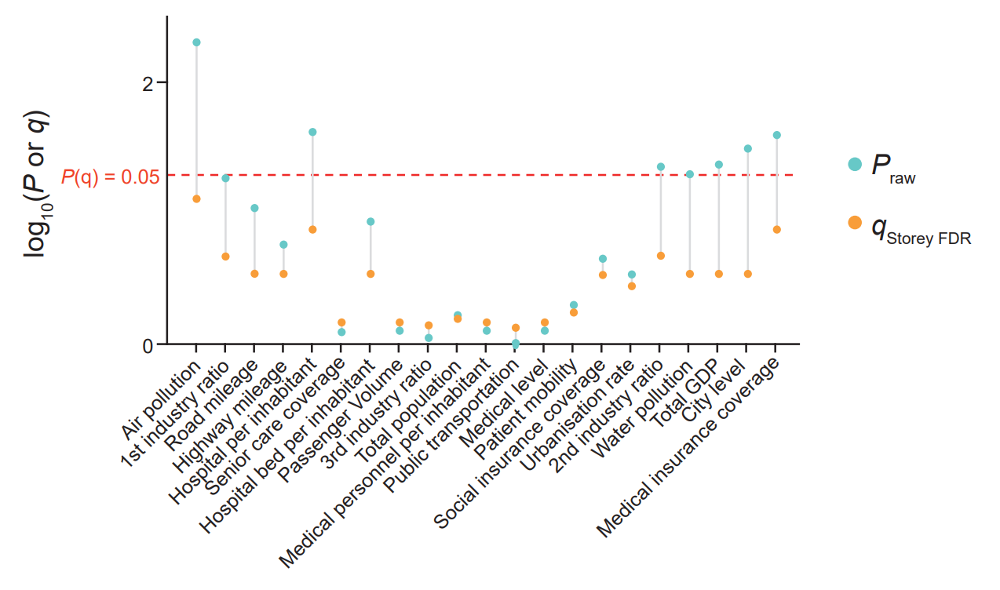

# City-level associations

The univariate analysis tests Spearman associations between ESL2.5 relative
abundance and 21 city variables. Nominal permutation P values and Storey FDR
q-values are retained in the result tables. The smallest Storey q-value is
0.0768, for air pollution.

The FDR adjustment applies to 21 separate marginal tests. These exploratory
associations are presented in Supplementary Fig. 4. Statistical significance
was not used to select variables for the urban principal component analysis.

The permutation results in `data/city_ESL25_spearman_permutation.tsv` are the
input to the multiple-testing scripts. The other TSV files retain the plotted
values and Storey q-values.

  

