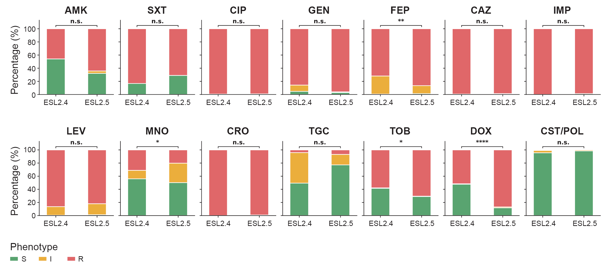
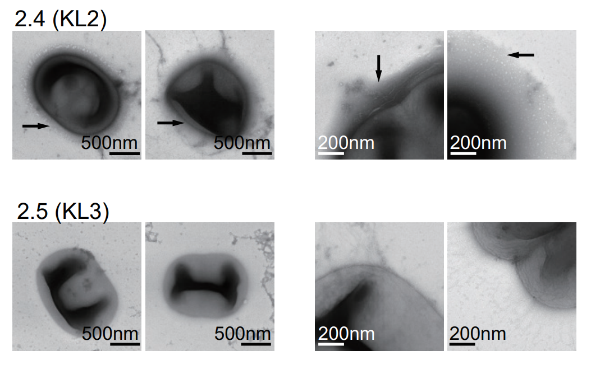
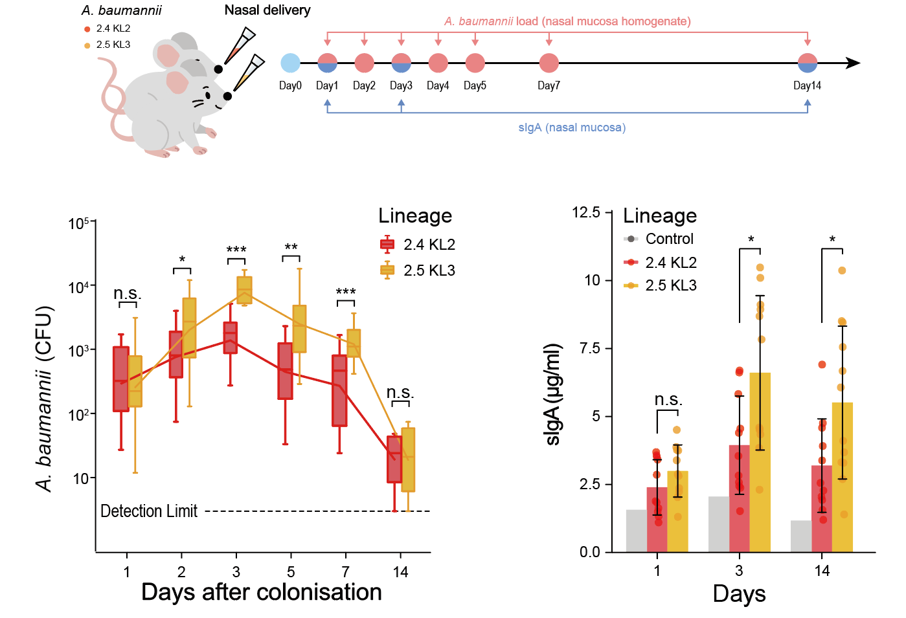
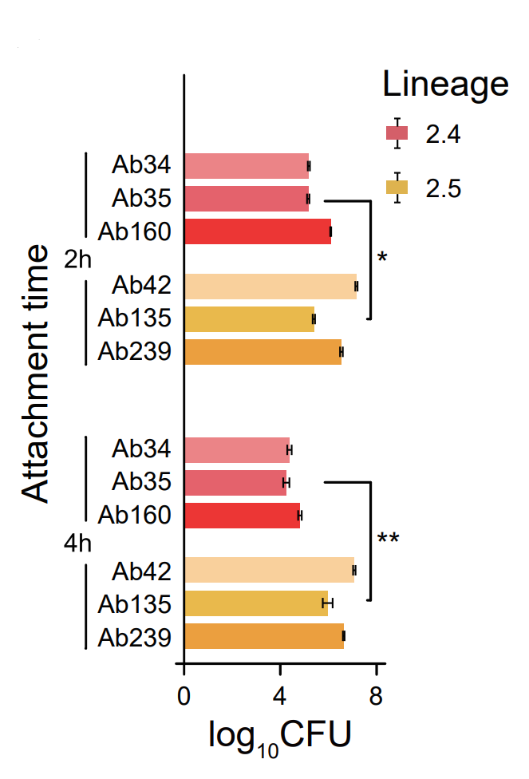

# Phenotype experiments

Phenotype measurements comparing ESL2.4 and ESL2.5 are grouped by biological
question. Each quantitative analysis has its own input table, derived results,
calculation script and definition of the independent experimental unit.

## Antimicrobial susceptibility

[`antimicrobial_susceptibility/`](antimicrobial_susceptibility/) contains
isolate-level clinical S/I/R calls, drug-level proportions, two-sided Fisher
exact tests and Benjamini-Hochberg-adjusted results.

<p align="left">
  
</p>

## Capsule architecture and capsular-polysaccharide production

[`transmission_electron_microscopy/`](transmission_electron_microscopy/)
documents fixation, negative staining and image acquisition.
[`capsular_polysaccharide/`](capsular_polysaccharide/) contains uronic-acid
measurements normalized to bacterial counts and summarized at isolate level.

<p align="left">
  
</p>

## Mouse colonisation and mucosal immunity

[`nasal_colonisation/`](nasal_colonisation/) contains mouse-level nasal CFU
measurements across six time points. [`secretory_iga/`](secretory_iga/)
documents the nasal-mucus ELISA.

<p align="left">
  
</p>

## A549-cell adhesion

[`a549_adhesion/`](a549_adhesion/) contains source plate counts, isolate-level
summaries and comparisons at MOI 10 and MOI 20.

<p align="left">
  
</p>

Gene-expression qPCR is retained in
[`gene_expression_qpcr/`](gene_expression_qpcr/) and presented with the gene
disruption analyses in the parent module README.

## Python dependencies

The analysis scripts require Python 3.10 or later and the following packages:

- NumPy 1.26 or later
- pandas 2.1 or later
- Matplotlib 3.8 or later
- SciPy 1.11 or later
- openpyxl 3.1 or later

They can be installed with:

```bash
python -m pip install "numpy>=1.26" "pandas>=2.1" "matplotlib>=3.8" "scipy>=1.11" "openpyxl>=3.1"
```
