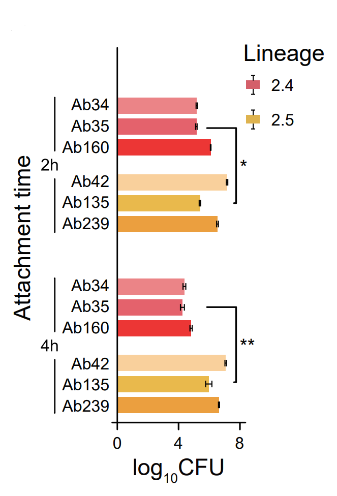

# A549-cell adhesion

Six isolates were tested: three ESL2.4 isolates and three ESL2.5 isolates. Each
isolate was measured at MOI 10 and MOI 20 in three independent experiments.
Rows in `data/selected_strains_MOI10_MOI20_logCFU.tsv` are independent
experiment-level measurements. Statistical tests use one mean value per
isolate at each MOI.

`data/source_adhesion_measurements.xlsx` contains the complete source plate
counts for five isolates per lineage; `data/adhesion_measurements.tsv` is its
tidy representation. The focused comparison uses three isolates per lineage
and three independent experiments per isolate at each MOI, retained in
`data/selected_strains_MOI10_MOI20_adhesion.tsv`.

`code/analyse_adhesion.py` averages experiment-level measurements within each
of the six isolates, writes isolate and lineage summaries, and performs the
two-sided exact Mann-Whitney U test at each MOI.

  

