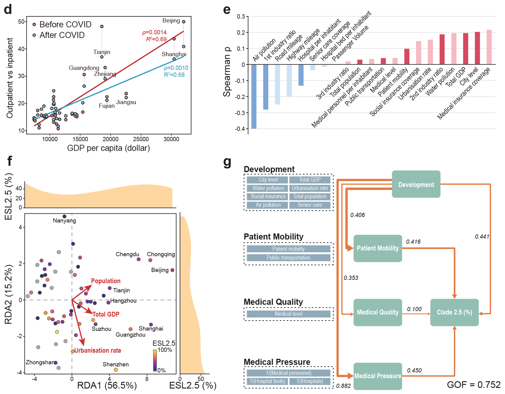
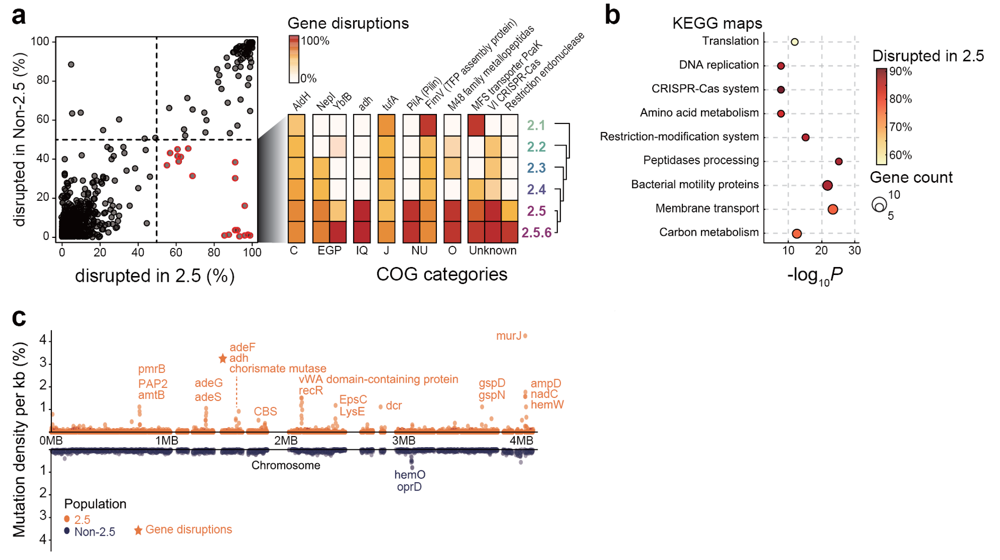

# Healthcare Infrastructure Shapes Evolutionary Trade-offs and Geographic Dissemination of Multidrug-Resistant *Acinetobacter baumannii*

This repository contains the analysis code, processed data and model implementation accompanying the study **Healthcare Infrastructure Shapes Evolutionary Trade-offs and Geographic Dissemination of Multidrug-Resistant *Acinetobacter baumannii***.

The study combines phylogenomics, phylogeography, sampling-sensitivity analyses, urban healthcare indicators, lineage-associated genomic variation, phenotype experiments and a spatial population-genetic model to examine the dissemination and ecological differentiation of the major ESL2 lineages in China.

## Repository map

| Section | Scope | Main entry point |
| --- | --- | --- |
| 1. Phylogenomics and transmission inference | Dated phylogeny, empirical city network, dissemination distance and velocity, temporal-signal tests, recombination masking and sampling sensitivity | [`1_Phylogenomics_and_Transmission_Inference/`](1_Phylogenomics_and_Transmission_Inference/) |
| 2. Evolutionary signatures and phenotypes | City-level associations, lineage-associated SNP-density peaks, antimicrobial susceptibility and experimental phenotypes | [`2_Evolutionary_Signatures/`](2_Evolutionary_Signatures/) |
| 3. Spatial transmission model | Synthetic city-network model of genotype competition, invasion and mobility intervention | [`3_AB_network/`](3_AB_network/) |

Each analysis directory separates `data/` from `code/` where possible. Its local README identifies the input tables, derived outputs, statistical unit and interpretation limits.

## 1. Phylogenomics and transmission inference

The [phylogenomics module](1_Phylogenomics_and_Transmission_Inference/) contains the shared genome metadata, dated tree, normalized city-to-city transmission table and the analyses used to assess their robustness.

### Time-resolved phylogeny and temporal signal

Root-to-tip temporal signal is evaluated for the combined ESL2 collection and separately for ESL2.3, ESL2.4 and ESL2.5. Time-dependent estimates are not interpreted for ESL2.3 because no detectable signal was found. Data and scripts are in [`temporal_signal/`](1_Phylogenomics_and_Transmission_Inference/temporal_signal/).

> **Figure placeholder — lineage-specific temporal signal**
> Add `1_Phylogenomics_and_Transmission_Inference/temporal_signal/root_to_tip_temporal_signal.png` here. The figure should contain the combined, ESL2.3, ESL2.4 and ESL2.5 root-to-tip regression panels.

### Date randomisation

Sampling dates are permuted among tips ten times. Within each permutation, the correlation is evaluated in ten independent 50% subsamples, and the median of those ten correlations represents the permutation. The observed estimate and its sampling interval are retained separately from the null distribution.

> **Figure placeholder — date randomisation**
> Add `1_Phylogenomics_and_Transmission_Inference/temporal_signal/date_randomisation.png` here. The figure should compare the observed correlation and sampling interval with the ten permutation-level medians for each lineage.

### Temporal-signal sampling sensitivity

The same temporal-signal statistic is evaluated under random, population-weighted, year-balanced, city-balanced and combined city/year-balanced sampling in [`temporal_signal/sampling_sensitivity/`](1_Phylogenomics_and_Transmission_Inference/temporal_signal/sampling_sensitivity/).

> **Figure placeholder — temporal-signal sampling sensitivity**
> Add `1_Phylogenomics_and_Transmission_Inference/temporal_signal/sampling_sensitivity/temporal_signal_sampling_sensitivity.png` here. The figure should show lineage-specific estimates across all five sampling strategies.

### Recombination masking

[`recombination/`](1_Phylogenomics_and_Transmission_Inference/recombination/) contains the chromosome-wide RecHMM, Gubbins and ClonalFrameML profiles, the low-recombination block coordinates and the SNP counts before and after masking. Recombinant regions are masked; the alignment is not treated as recombination-free.

> **Figure placeholder — recombination landscape**
> Add `1_Phylogenomics_and_Transmission_Inference/recombination/recombination_landscape.png` here. The figure should show the three recombination profiles, mutation events and the low-recombination block used for phylogenetic reconstruction.

### Empirical transmission structure

The empirical network is inferred from changes in reconstructed geographic state along the dated phylogeny. Its nodes are sampled cities and its edges are inferred intercity transitions; it is not a directly observed hospital-transfer network. [`Network.py`](1_Phylogenomics_and_Transmission_Inference/Network.py) evaluates the resolution scan, within- versus cross-module connection weights, transmission between city levels and transmission weight by city hierarchy.

  

### Transmission-network sampling sensitivity

[`network_sensitivity/`](1_Phylogenomics_and_Transmission_Inference/network_sensitivity/) reconstructs the empirical network under five geographic and temporal sampling strategies and compares network metrics and community assignments using NMI and ARI.

> **Figure placeholder — transmission-network sampling sensitivity**
> Add `1_Phylogenomics_and_Transmission_Inference/network_sensitivity/network_sampling_sensitivity.png` here. The figure should show the network-metric intervals and community-stability results across the five strategies.

### Dissemination distance and velocity

[`Speed.py`](1_Phylogenomics_and_Transmission_Inference/Speed.py) summarizes phylogeny-based dissemination distance and velocity. The existing figure compares lineage-specific spread speeds between epidemiological periods and geographic distance over evolutionary time.

  

### SNP-distance validation of spatial spread

[`snp_distance_validation/`](1_Phylogenomics_and_Transmission_Inference/snp_distance_validation/) compares divergence time with recombination-masked pairwise SNP distance and tests whether the spatial conclusions depend on molecular dating.

> **Figure placeholder — SNP-distance validation**
> Add `1_Phylogenomics_and_Transmission_Inference/snp_distance_validation/snp_distance_validation.png` here. The figure should summarize divergence time versus SNP distance, geographic spread versus SNP distance and the period-specific km-per-SNP comparison.

### Sampling sensitivity of lineage prevalence

Annual and overall ESL2.3, ESL2.4 and ESL2.5 proportions are recalculated using random downsampling, year balancing, city balancing and combined city/year balancing in [`clade_prevalence_sensitivity/`](1_Phylogenomics_and_Transmission_Inference/clade_prevalence_sensitivity/).

> **Figure placeholder — clade-prevalence sampling sensitivity**
> Add `1_Phylogenomics_and_Transmission_Inference/clade_prevalence_sensitivity/clade_prevalence_sampling_sensitivity.png` here. The figure should compare the observed annual lineage proportions with the intervals from all four resampling schemes.

## 2. Evolutionary signatures and phenotype experiments

The [evolutionary-signatures module](2_Evolutionary_Signatures/) links city characteristics and genomic measurements to observed lineage distributions, and provides the experimental measurements used to compare ESL2.4 and ESL2.5.

### City connectivity and patient mobility

[`Degree.py`](2_Evolutionary_Signatures/Degree.py) evaluates the association between empirical city-network connectivity and lineage prevalence. The existing figure contains the associations between inferred transmission events and ESL2.4/ESL2.5 prevalence, together with lineage prevalence across patient-mobility strata.

  

### Urban attributes and multivariate modelling

The top-level city tables contain curated urban covariates and provincial outpatient/inpatient indicators. The existing figure contains the outpatient/inpatient comparison, ranked city-variable correlations, RDA and SEM.

  

### Multiple testing of city-level associations

[`city_associations/`](2_Evolutionary_Signatures/city_associations/) retains permutation-based Spearman tests for 22 city variables, nominal P values and Storey FDR q-values. These marginal tests are documented separately from the multivariate RDA and SEM.

> **Figure placeholder — city-variable multiple testing**
> Add `2_Evolutionary_Signatures/city_associations/city_association_multiple_testing.png` here. The figure should display the nominal permutation P values and Storey q-values for all 22 variables.

### Gene disruptions and functional enrichment

The top-level pseudogene and mutation tables support the lineage-associated gene-disruption, COG/KEGG enrichment and chromosome-wide mutation-density summaries shown in the existing figure.

  

### Annotated SNP-density peaks

[`snp_density/`](2_Evolutionary_Signatures/snp_density/) provides 10-kb profiles for all annotated SNPs and the nonsynonymous subset. The regions are reported as SNP-density peaks, with residual recombination considered for the exceptional high-synonymous peak.

> **Figure placeholder — annotated SNP-density peaks**
> Add `2_Evolutionary_Signatures/snp_density/snp_density_peaks.png` here. The figure should compare all-SNP and nonsynonymous profiles and annotate the principal peaks, including the high-synonymous peak.

### Phenotype experiments

The [phenotype-experiment section](2_Evolutionary_Signatures/phenotype_experiments/) is organized by assay:

| Experiment | Available material | Figure position |
| --- | --- | --- |
| [Antimicrobial susceptibility](2_Evolutionary_Signatures/phenotype_experiments/antimicrobial_susceptibility/) | Isolate-level S/I/R calls, drug-level comparisons and FDR-adjusted statistics | `2_Evolutionary_Signatures/phenotype_experiments/antimicrobial_susceptibility/antimicrobial_susceptibility.png` |
| [Capsular polysaccharide](2_Evolutionary_Signatures/phenotype_experiments/capsular_polysaccharide/) | Uronic-acid measurements, isolate summaries and lineage/KL-type comparisons | `2_Evolutionary_Signatures/phenotype_experiments/capsular_polysaccharide/capsular_polysaccharide.png` |
| [Gene-expression qPCR](2_Evolutionary_Signatures/phenotype_experiments/gene_expression_qpcr/) | Technical Ct replicates, isolate-level normalization and target-wise comparisons | `2_Evolutionary_Signatures/phenotype_experiments/gene_expression_qpcr/gene_expression_qpcr.png` |
| [A549-cell adhesion](2_Evolutionary_Signatures/phenotype_experiments/a549_adhesion/) | Source plate counts, focused isolate comparison and isolate-level statistics | `2_Evolutionary_Signatures/phenotype_experiments/a549_adhesion/a549_adhesion.png` |
| [Mouse nasal colonisation](2_Evolutionary_Signatures/phenotype_experiments/nasal_colonisation/) | Longitudinal mouse-level bacterial loads and time-point-specific comparisons | `2_Evolutionary_Signatures/phenotype_experiments/nasal_colonisation/nasal_colonisation.png` |
| [Systemic-infection survival](2_Evolutionary_Signatures/phenotype_experiments/systemic_infection_survival/) | Mouse-level event data, Kaplan-Meier estimates and log-rank analysis | `2_Evolutionary_Signatures/phenotype_experiments/systemic_infection_survival/systemic_infection_survival.png` |
| [Transmission electron microscopy](2_Evolutionary_Signatures/phenotype_experiments/transmission_electron_microscopy/) | Experimental method; quantitative micrograph measurements are not available | `2_Evolutionary_Signatures/phenotype_experiments/transmission_electron_microscopy/transmission_electron_microscopy.png` |
| [Nasal secretory IgA](2_Evolutionary_Signatures/phenotype_experiments/secretory_iga/) | Experimental method; the quantitative source table is not available | `2_Evolutionary_Signatures/phenotype_experiments/secretory_iga/secretory_iga.png` |

The independent experimental unit is defined in each assay README. In particular, A549 comparisons use the isolate mean, qPCR technical replicates are averaged within isolates, and longitudinal colonisation measurements retain the mouse as the unit. These experiments establish measured associations in representative isolates; they do not by themselves establish that capsule type or a particular gene disruption causes a lineage-level phenotype.

Each assay README places its figure instruction immediately after the corresponding methods and statistical-unit description.

## 3. Spatial transmission model

[`3_AB_network/`](3_AB_network/) contains a synthetic population-genetic simulation of competing transmission strategies across a heterogeneous city network. It supports basic, invasion and three-phase mobility-intervention scenarios.

The simulated network is conceptually motivated by the contrast between metropolitan and peripheral healthcare environments but is not fitted to the empirical genomic network or to direct patient-transfer data. See the [model README](3_AB_network/README.md) for commands, parameters and output formats.

> **Figure placeholder — spatial transmission model**
> Add `3_AB_network/model_summary.png`. The figure should show the synthetic network, lineage-frequency trajectories and the basic/invasion/mobility-intervention scenarios. Existing sensitivity PDFs remain available under [`3_AB_network/example_res/sensitivity_results/`](3_AB_network/example_res/sensitivity_results/).

## Reproducing an analysis

There is no single top-level driver because the repository combines phylogenetic software, statistical summaries, experimental assays and simulation. For a specific result:

1. Open the relevant module README from the map above.
2. Check the stated source table, statistical unit and assumptions.
3. Run the script from its analysis directory so that its relative `data/` paths resolve correctly.
4. Compare the regenerated table with the included derived output before recreating a figure.

Large raw sequencing files and the low-recombination-block FASTA are not stored in this repository. Processed inputs needed for the documented downstream analyses are included where redistribution is possible. Figure image files are included only for analyses already represented in the repository; additional panels can be regenerated from the corresponding source tables and scripts.

## Software requirements

Most tabular analyses use Python 3.10 or later. Common packages are:

- NumPy, pandas and SciPy
- Matplotlib and seaborn
- openpyxl
- NetworkX, python-louvain and ETE Toolkit
- Plotly for interactive model output

The phenotype module provides its [Python dependency declaration](2_Evolutionary_Signatures/phenotype_experiments/#python-dependencies), and the simulation has a separate [`requirements.txt`](3_AB_network/requirements.txt). Individual scripts may use only a subset of these packages.

Upstream phylogenomic reconstruction additionally used EToKi, IQ-TREE 2, RecHMM, Gubbins, ClonalFrameML, TempEst, TreeTime and BEAST 2. Selected multivariate analyses use R. These external tools are not bundled here.

## Data interpretation

- Temporal signal is evaluated by lineage. Time-dependent estimates are not interpreted for ESL2.3 because no detectable signal was found.
- Recombination is masked; the input alignment is not described as recombination-free.
- Network and annual clade-proportion sensitivity analyses address unequal sampling among cities and years, but percentages remain conditional on the available genomes.
- Nominal city-level associations and their FDR-adjusted results are both retained. The univariate tests and multivariate RDA/SEM address different questions.
- The systemic-infection subset analysis is outcome-dependent and is documented as exploratory in its local README and selection table.
- Empirical phylogeographic inference and the synthetic transmission model are separate analytical objects.

## Citation

If you use this repository, its code or processed source data, please cite the accompanying paper:

Li S, Wu Y, Zhou Y, Zhong L, Jiang Y, Wang Y, Li J, Lin H, Li H, Xia S, Du H, Zhang R, Lou Y, Wang S, *et al.* **Healthcare Infrastructure Shapes Evolutionary Trade-offs and Geographic Dissemination of Multidrug-Resistant *Acinetobacter baumannii*.**

Please also cite the original software and external data sources relevant to the analysis being reused.

## License

See [`LICENSE`](LICENSE).
