# Healthcare connectivity and ecological differentiation of multidrug-resistant *Acinetobacter baumannii*

This repository contains the analysis code, processed data and model implementation accompanying the study **Healthcare connectivity and ecological differentiation of multidrug-resistant *Acinetobacter baumannii*** (Old name as **Healthcare connectivity and ecological differentiation of multidrug-resistant *Acinetobacter baumannii***).

The study combines phylogenomics, phylogeography, sampling-sensitivity analyses, urban healthcare indicators, lineage-associated genomic variation, phenotype experiments and a spatial population-genetic model to examine the dissemination and ecological differentiation of the major ESL2 lineages in China.

## Repository map

| Section | Scope | Main entry point |
| --- | --- | --- |
| 1. Phylogenomics and transmission inference | Dated phylogeny, empirical city network, dissemination distance and velocity, temporal-signal tests, recombination masking and sampling sensitivity | [`1_Phylogenomics_and_Transmission_Inference/`](1_Phylogenomics_and_Transmission_Inference/) |
| 2. Evolutionary signatures and phenotypes | City-level associations, lineage-associated SNP-density peaks, antimicrobial susceptibility and experimental phenotypes | [`2_Evolutionary_Signatures/`](2_Evolutionary_Signatures/) |
| 3. Spatial transmission model | Synthetic city-network model of genotype competition, invasion and mobility intervention | [`3_AB_network/`](3_AB_network/) |

Each analysis directory separates `data/` from `code/` where possible. Its local README identifies the input tables, calculation steps, derived outputs, statistical unit and expected figure.

## 1. Phylogenomics and transmission inference

The [phylogenomics module](1_Phylogenomics_and_Transmission_Inference/) contains the shared genome metadata, dated tree, normalized city-to-city transmission table and the analyses used to assess their robustness.

### Time-resolved phylogeny and temporal signal

Root-to-tip regression is evaluated for the combined ESL2 collection and separately for ESL2.3, ESL2.4 and ESL2.5. ESL2.4 (R = 0.33, permutation P = 0.001) and ESL2.5 (R = 0.36, permutation P = 0.001) provide the lineage-specific temporal signal used for molecular dating. ESL2.3 yielded R = 0.01 and permutation P = 0.974 and is excluded from downstream temporal estimates. Data, summary statistics and plotting scripts are in [`temporal_signal/`](1_Phylogenomics_and_Transmission_Inference/temporal_signal/).

  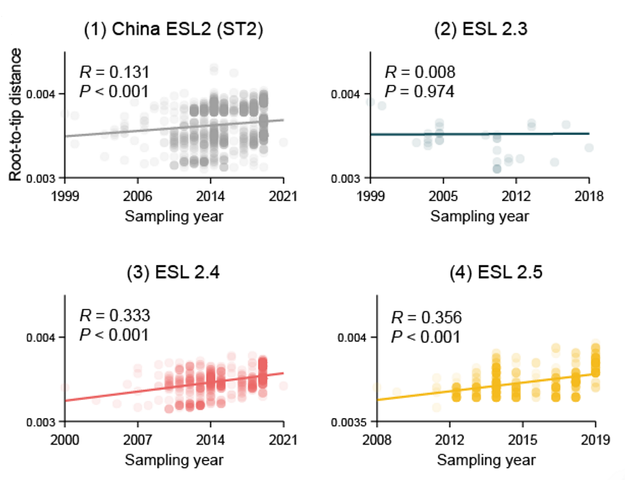

### Date randomisation

Sampling dates are permuted among tips ten times. Within each permutation, the correlation is evaluated in ten independent 50% subsamples, and the median of those ten correlations represents the permutation. The observed estimate and its sampling interval are retained separately from the null distribution.

  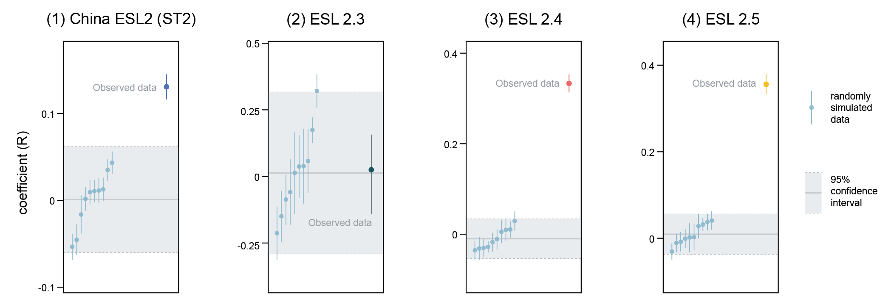

### Temporal-signal sampling sensitivity

The same temporal-signal statistic is evaluated under random, population-weighted, year-balanced, city-balanced and combined city/year-balanced sampling in [`temporal_signal/sampling_sensitivity/`](1_Phylogenomics_and_Transmission_Inference/temporal_signal/sampling_sensitivity/).

  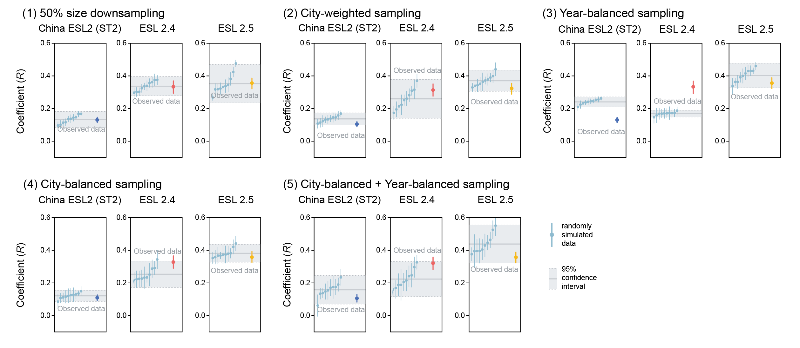

### Recombination masking

[`recombination/`](1_Phylogenomics_and_Transmission_Inference/recombination/) contains chromosome-wide RecHMM, Gubbins and ClonalFrameML profiles summarized in consecutive 10-kb windows. The phylogenetic block spans NC_017847.1 positions 1,215,000-2,930,999; recombination masking reduced its SNP set from 35,609 to 23,524. The directory provides the source workbook, standardized event tables, block coordinates and scripts for regenerating the recombination landscape.

  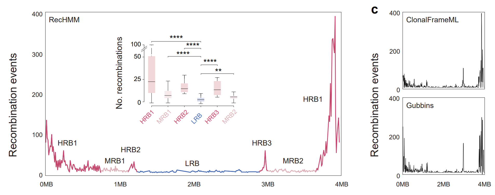

### Empirical transmission structure

The empirical network is a city-level phylogeographic transition network reconstructed from changes in geographic state along the dated phylogeny. Nodes represent sampled cities, directed edges represent inferred intercity transitions and edge weights record normalized transition counts. [`Network.py`](1_Phylogenomics_and_Transmission_Inference/Network.py) applies Louvain community detection and scans the resolution parameter to evaluate alternative community partitions.

The four panels below show the number of detected clusters and modularity Q across the resolution scan, the distribution of within-module and cross-module transmission weights, the proportions of events occurring within and across city-hierarchy levels, and transmission weight per city for mega-cities, provincial cities and non-provincial cities. The city hierarchy follows the [official urban classification cited in the study](https://www.ndrc.gov.cn/xwdt/ztzl/xxczhjs/ghzc/201605/t20160509_971910.html). These panels form part of the extended-data analysis of the modular and hierarchical structure of the China transmission network.

  

### Transmission-network sampling sensitivity

[`network_sensitivity/`](1_Phylogenomics_and_Transmission_Inference/network_sensitivity/) reconstructs the empirical network under five geographic and temporal sampling strategies and compares network metrics and community assignments using NMI and ARI.

  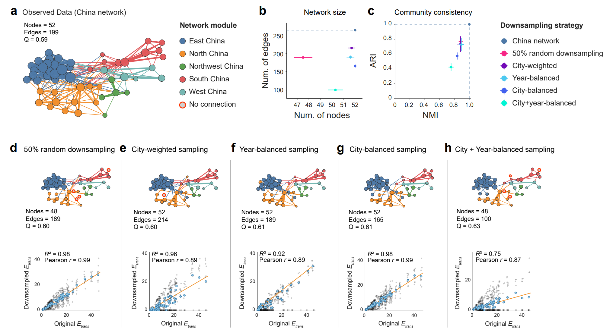

### Dissemination distance and velocity

[`Speed.py`](1_Phylogenomics_and_Transmission_Inference/Speed.py) combines geographic distance between reconstructed parent and descendant locations with the corresponding branch-time interval, following the phylogeny-based framework described by [Belman et al.](https://doi.org/10.1038/s41586-024-07626-3). Pairwise distances between Chinese cities were obtained through the Baidu Map API and are retained in [`PairwiseChinaCities.distance`](1_Phylogenomics_and_Transmission_Inference/PairwiseChinaCities.distance).

This legacy composite shows the earlier velocity estimates alongside accumulated geographic spread. Revised Fig. 2c uses fitted lineage estimates from the sampling-adjustment module. Fig. 2d shows the accumulated spread distance over evolutionary time.

  

### Pandemic-period dissemination and sampling adjustment

The [sampling-adjustment analysis](1_Phylogenomics_and_Transmission_Inference/covid_sampling_adjustment/) accounts for annual genomic sampling intensity and sampled-city counts. The estimated changes were −36.4% for ESL2.4 (P = 0.219) and −54.7% for ESL2.5 (P = 0.016). The difference in change between lineages was imprecise. Speed estimates and CIs are conditional on fixed lineage-specific clock factors.

  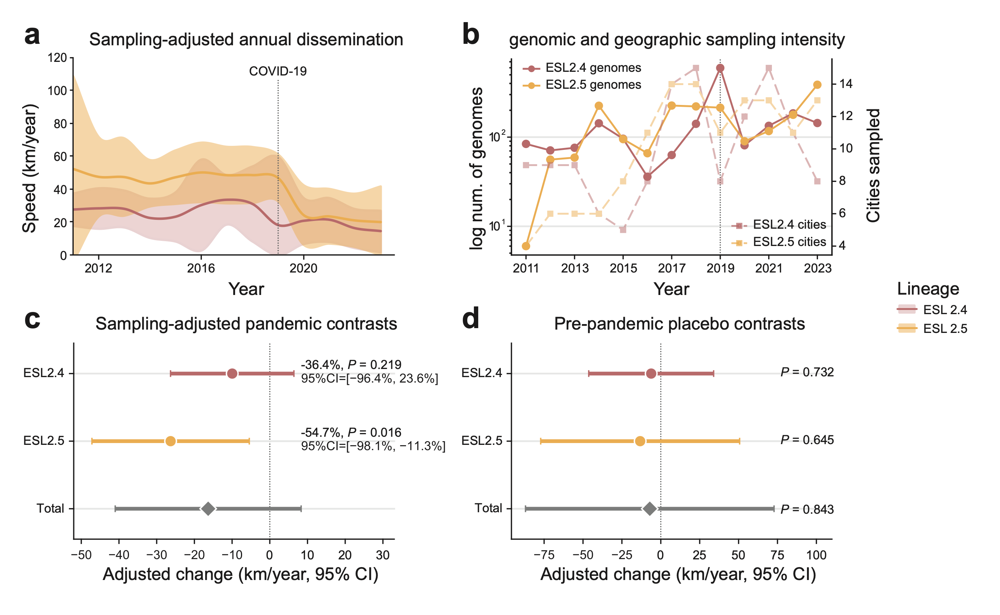

### SNP-distance validation of spatial spread

[`snp_distance_validation/`](1_Phylogenomics_and_Transmission_Inference/snp_distance_validation/) provides pair-level comparisons between divergence time and recombination-masked SNP distance, SNP-based year calibration, geographic-distance bins and period-specific kilometres-per-SNP summaries.

  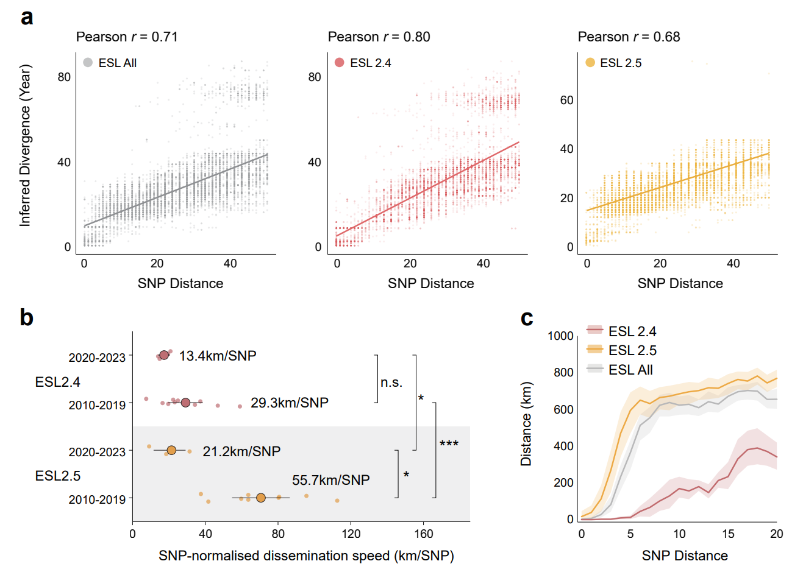

### Sampling sensitivity of lineage prevalence

Annual and overall ESL2.3, ESL2.4 and ESL2.5 proportions are recalculated using random downsampling, year balancing, city balancing and combined city/year balancing in [`clade_prevalence_sensitivity/`](1_Phylogenomics_and_Transmission_Inference/clade_prevalence_sensitivity/).

  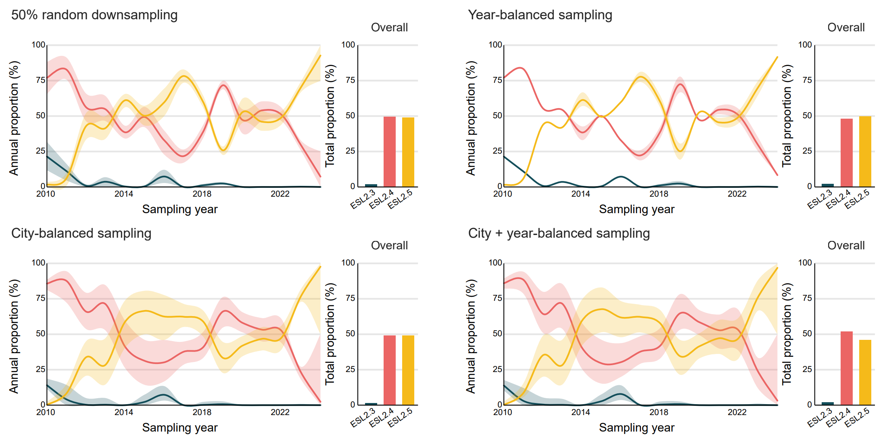

## 2. Evolutionary signatures and phenotype experiments

The [evolutionary-signatures module](2_Evolutionary_Signatures/) links city characteristics and genomic measurements to observed lineage distributions, and provides the experimental measurements used to compare ESL2.4 and ESL2.5.

### City connectivity and patient mobility

[`Degree.py`](2_Evolutionary_Signatures/Degree.py) joins normalized city-level transmission counts with lineage prevalence and calculates Spearman associations for ESL2.4 and ESL2.5. Panels a and b show the negative association between transmission connectivity and ESL2.4 prevalence (Spearman ρ = -0.32, P = 0.017) and the positive association with ESL2.5 prevalence (ρ = 0.61, P < 0.001). Panel c compares the prevalence of both lineages across patient-mobility levels I-IV. The healthcare mobility classification was derived from the national healthcare supply-demand and intercity mobility analysis reported by [Zhao et al.](https://doi.org/10.1038/s44284-024-00185-8). These panels correspond to Fig. 3a-c.

  

### Genomic sampling depth and specimen ascertainment

[City-level sampling sensitivity](2_Evolutionary_Signatures/network_sampling_bias/) found a positive association of network degree with sampling depth (Spearman ρ = 0.559, 48 cities). The degree–prevalence association weakened in the common 47-city sample after adjustment for sampling and urban characteristics. [Specimen ascertainment](2_Evolutionary_Signatures/specimen_ascertainment/) compares invasive-specimen proportions and summarizes bloodstream-only lineage composition descriptively.

  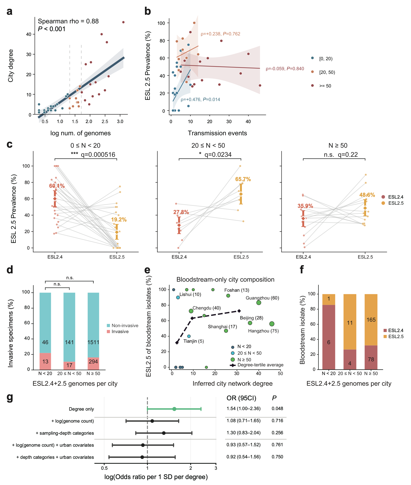

### Urban attributes and principal component analysis

[ChinaCityInfo.xlsx](2_Evolutionary_Signatures/ChinaCityInfo.xlsx) contains demographic, socioeconomic and healthcare variables curated from the [China Statistical Yearbook](https://www.stats.gov.cn) and the [China Health Statistical Yearbook](https://www.nhc.gov.cn/mohwsbwstjxxzx/tjnj). The [urban PCA](2_Evolutionary_Signatures/urban_pca/) was fitted to 15 transformed predictors in 60 cities. PC1 and PC2 explain 55.9% and 16.1% of variance in those predictors. ESL2.5 prevalence is added after fitting. Fig. 3f compares provincial GDP per capita with outpatient-to-inpatient ratios using [TrueValueOI.xlsx](2_Evolutionary_Signatures/TrueValueOI.xlsx). These ratios summarize relative outpatient visits and inpatient admissions.

  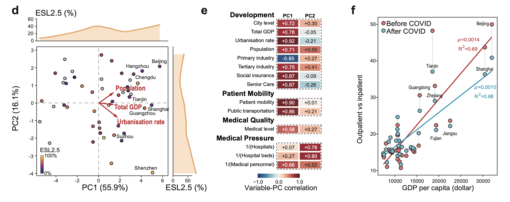

### Historical urban-characteristic sensitivity

[Historical matching](2_Evolutionary_Signatures/historical_urban_attributes/) compares contemporary attributes with 2010–2017 observed values for 18 cities and 1,477 genomes. Matched PC1 scores correlate at ρ = 0.740, while some healthcare associations vary with the measurement period. None of the 13 historical correlations passed BH correction.

  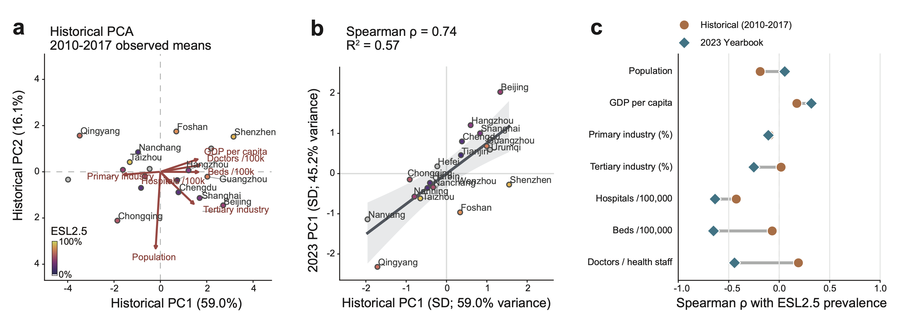

### Multiple testing of city-level associations

[`city_associations/`](2_Evolutionary_Signatures/city_associations/) retains permutation-based Spearman tests for 22 city variables, nominal P values, Benjamini-Hochberg adjustment and Storey q-values. The smallest Storey q-value is 0.0768 for air pollution; the directory contains the complete table and plotting scripts.

  

No city variable passed the reported 5% Storey FDR threshold in Supplementary Fig. 4.

### Gene disruptions, functional enrichment and gene expression

[`ESL2.5_Pseudogenes.txt`](2_Evolutionary_Signatures/ESL2.5_Pseudogenes.txt) records disruption frequencies across ESL2.1-ESL2.5 together with gene annotations and COG categories. Putative disruptions comprise truncated coding sequences, frameshifts and premature stop codons. IS elements were identified with ISFinder, and 15 representative predictions were examined by PCR and bidirectional Sanger sequencing. Ancestral states were reconstructed on the dated phylogeny to distinguish early clade-associated events, parallel losses and recent terminal-branch losses. The disruption frequencies support the lineage comparison, COG heat map and KEGG enrichment panels; the mutation tables provide the chromosome-wide density series.

Panel a compares gene-disruption frequencies in ESL2.5 and non-ESL2.5 lineages and summarizes selected loci across COG categories. Panel b shows KEGG enrichment among genes preferentially disrupted in ESL2.5. Panel c compares chromosome-wide mutation density in ESL2.5 and non-ESL2.5 populations and labels selected high-density loci and gene disruptions. The composite corresponds to Fig. 4a-c; effect-type counts and annotations for the highlighted SNP-density peaks are described in the following section.

  

The phylogenetic distributions of representative nonsense mutations, truncated loci and insertion-mediated disruptions show when these events arose across ESL lineages.

  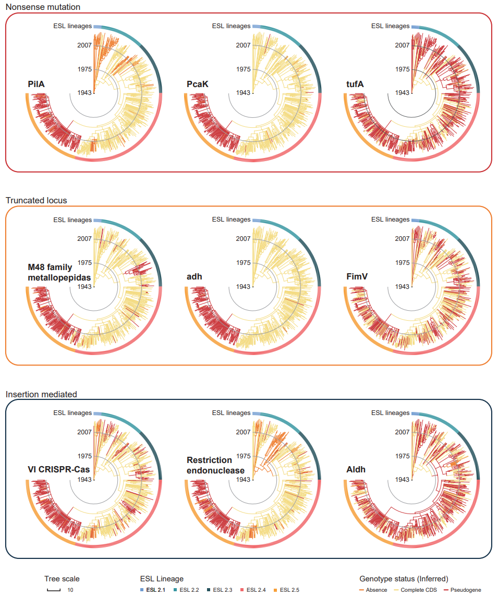

Expression of selected disruption-associated loci was assessed from technical-triplicate Ct measurements in three ESL2.4 and three ESL2.5 isolates. Ct values were averaged within each isolate, normalized to 16S rRNA and summarized as delta Ct and 2^-delta Ct. The isolate is the comparison unit. Source values, normalization and target-wise statistics are provided in [`gene_expression_qpcr/`](2_Evolutionary_Signatures/phenotype_experiments/gene_expression_qpcr/).

  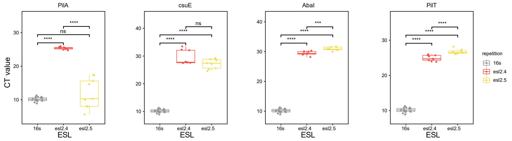

### Annotated SNP-density peaks

[`snp_density/`](2_Evolutionary_Signatures/snp_density/) provides parallel 10-kb profiles for all annotated SNPs and the protein-changing subset. The largest ESL2.5 peak, at 3,897,000-3,897,999 bp, contains 65 variants: 54 synonymous and 11 protein-changing. Effect-type counts and gene annotations are retained for every highlighted window so that the composition of each peak can be inspected directly. We also provide [an interactional version of this figure](https://naclist.github.io/naclist-portfolio/sources/ab_mutation_annotations/).

  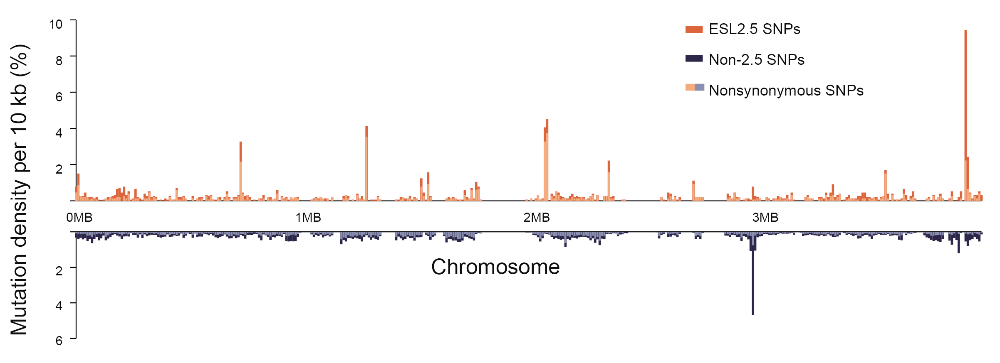

### Phenotype experiments

The [phenotype-experiment section](2_Evolutionary_Signatures/phenotype_experiments/) contains the processed measurements, statistical tables and calculation scripts for the following experimental comparisons.

#### Antimicrobial susceptibility

Clinical susceptible, intermediate and resistant calls were interpreted using the hospital microbiology records and CLSI M100 breakpoints. Resistance proportions were compared between ESL2.4 and ESL2.5 with two-sided Fisher exact tests, followed by Benjamini-Hochberg correction across antimicrobial agents. Isolate-level calls and drug-level summaries are in [`antimicrobial_susceptibility/`](2_Evolutionary_Signatures/phenotype_experiments/antimicrobial_susceptibility/).

  

#### Capsule architecture and capsular-polysaccharide production

Capsule-associated surface structures were examined by negative-stain transmission electron microscopy. Overnight LB cultures were washed, fixed in 2.5% glutaraldehyde, applied to glow-discharged continuous-carbon grids, stained with 3% uranyl acetate and imaged on a Hitachi HT7800 at 80-100 kV. Capsular material from cultures normalized to approximately 10^9 CFU was extracted with 1% Zwittergent 3-14 in 100 mM citric acid and ethanol precipitation. Uronic acid was quantified by the sodium-tetraborate/carbazole reaction at 530 nm using K-type-matched standards. Protocol and measurement files are divided between [`transmission_electron_microscopy/`](2_Evolutionary_Signatures/phenotype_experiments/transmission_electron_microscopy/) and [`capsular_polysaccharide/`](2_Evolutionary_Signatures/phenotype_experiments/capsular_polysaccharide/). The composite corresponds to Fig. 4d.

  

#### Mouse colonisation and mucosal immunity

Three isolates from each lineage were examined in the nasal-colonisation model. Anaesthetized mice received 40 microlitres of bacterial suspension intranasally, and nasal tissues collected on days 1, 2, 3, 5, 7 and 14 were homogenized and plated for CFU enumeration. Nasal-mucus sIgA was quantified by ELISA at the specified sampling times and calculated from the assay standard curve. Data and analysis details are in [`nasal_colonisation/`](2_Evolutionary_Signatures/phenotype_experiments/nasal_colonisation/) and [`secretory_iga/`](2_Evolutionary_Signatures/phenotype_experiments/secretory_iga/). The composite corresponds to Fig. 4h-j.

  

  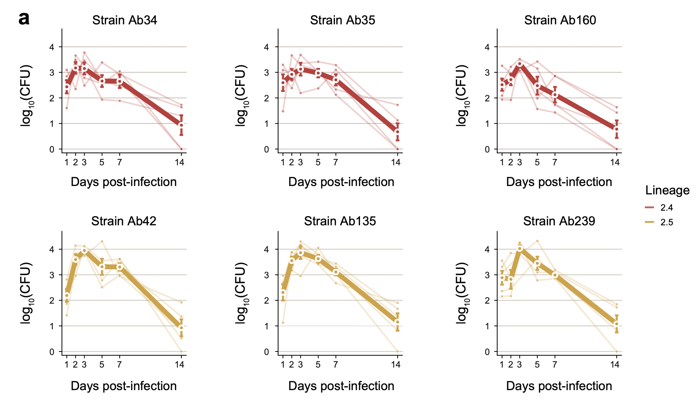

#### A549-cell adhesion

A549 cells were maintained in DMEM with 10% fetal bovine serum and incubated with logarithmic-phase bacteria at MOI 10 or 20. After four hours, monolayers were washed five times, lysed with 1% Triton X-100 and plated for adherent CFU. Adhesion was calculated relative to the inoculum. Three isolates per lineage were measured in three independent experiments, and statistical comparisons use one mean per isolate at each MOI. Source plate counts and analysis scripts are in [`a549_adhesion/`](2_Evolutionary_Signatures/phenotype_experiments/a549_adhesion/). This figure corresponds to Fig. 4k.

  

## 3. Spatial transmission model

[`3_AB_network/`](3_AB_network/) contains a synthetic population-genetic simulation of competing transmission strategies across a heterogeneous city network. It supports basic, invasion and three-phase mobility-intervention scenarios.

The simulation uses synthetic city nodes and mobility links to test how metropolitan/peripheral mobility structure and contrasting colonisation/infection strategies affect genotype persistence. Network construction, fitness parameters and migration rates are defined in [`config.py`](3_AB_network/config.py); the [model README](3_AB_network/README.md) describes the basic, invasion and three-phase mobility-intervention scenarios.

  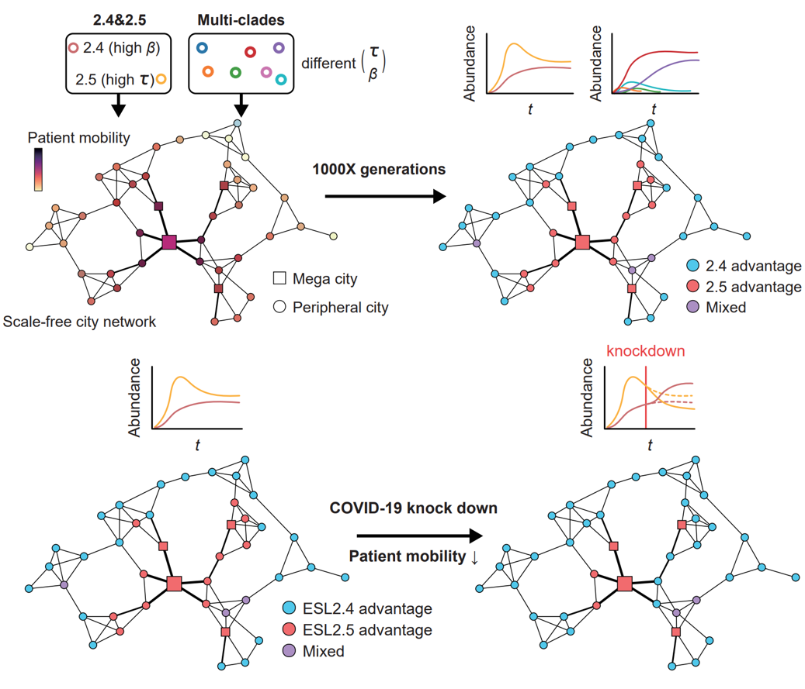

Existing sensitivity PDFs remain available under [`3_AB_network/example_res/sensitivity_results/`](3_AB_network/example_res/sensitivity_results/).

## Figure-to-code map

| Figure | Analysis |
| --- | --- |
| Fig. 2c and Fig. 5j (fitted lineage series), Supplementary Fig. 7 | [Dissemination adjustment](1_Phylogenomics_and_Transmission_Inference/covid_sampling_adjustment/) |
| Fig. 3a–c | [Degree and mobility](2_Evolutionary_Signatures/Degree.py) |
| Fig. 3d–e (display values) | [Figure data](2_Evolutionary_Signatures/urban_pca/data/Fig3de_plot_values.tsv) |
| Fig. 3f | [Provincial outpatient-to-inpatient data](2_Evolutionary_Signatures/TrueValueOI.xlsx) |
| Supplementary Fig. 3a–c | [Network sampling bias](2_Evolutionary_Signatures/network_sampling_bias/) |
| Supplementary Fig. 3d–f | [Specimen ascertainment](2_Evolutionary_Signatures/specimen_ascertainment/) |
| Supplementary Fig. 3g | [Fractional-logit models](2_Evolutionary_Signatures/network_sampling_bias/adjusted_models/) |
| Supplementary Fig. 4 | [Univariate city associations](2_Evolutionary_Signatures/city_associations/) |
| Supplementary Fig. 6a–b | [Nasal colonisation](2_Evolutionary_Signatures/phenotype_experiments/nasal_colonisation/) and [A549 adhesion](2_Evolutionary_Signatures/phenotype_experiments/a549_adhesion/) |
| Supplementary Fig. 8a–c | [Historical urban attributes](2_Evolutionary_Signatures/historical_urban_attributes/) |

## Reproducing an analysis

Reproduction is organized by analysis module. For a specific result:

1. Open the relevant module README from the map above.
2. Check the stated source table, statistical unit and assumptions.
3. Run the script from its analysis directory so that its relative `data/` paths resolve correctly.
4. Compare the regenerated table with the included derived output before recreating a figure.

Large raw sequencing files and the low-recombination-block FASTA remain external to this repository. The repository contains the processed inputs used by the documented downstream analyses. Each module README maps source tables to calculation scripts, derived outputs and the expected figure filename.

## Software requirements

Most tabular analyses use Python 3.10 or later. Install revision dependencies with `python -m pip install -r requirements-revision.txt`. Consult the [source and reproducibility checks](REVISION_SYNC_DISCREPANCIES.md) for unresolved differences. Common packages are:

- NumPy, pandas and SciPy
- Matplotlib and seaborn
- openpyxl
- NetworkX, python-louvain and ETE Toolkit
- Plotly for interactive model output

The phenotype module provides its [Python dependency declaration](2_Evolutionary_Signatures/phenotype_experiments/#python-dependencies), and the simulation has a separate [`requirements.txt`](3_AB_network/requirements.txt). Individual scripts may use only a subset of these packages.

Upstream phylogenomic reconstruction additionally used EToKi, IQ-TREE 2, RecHMM, Gubbins, ClonalFrameML, TempEst, TreeTime and BEAST 2. Selected multivariate analyses use R. Install these tools separately when rebuilding the corresponding upstream results.

## Citation

If you use this repository, its code or processed source data, please cite the accompanying paper:

Li S, Wu Y, Zhou Y, Zhong L, Jiang Y, Wang Y, Li J, Lin H, Li H, Xia S, Du H, Zhang R, Lou Y, Wang S, *et al.* **Healthcare connectivity and ecological differentiation of multidrug-resistant *Acinetobacter baumannii*.**

Please also cite the original software and external data sources relevant to the analysis being reused.

## License

See [`LICENSE`](LICENSE).
