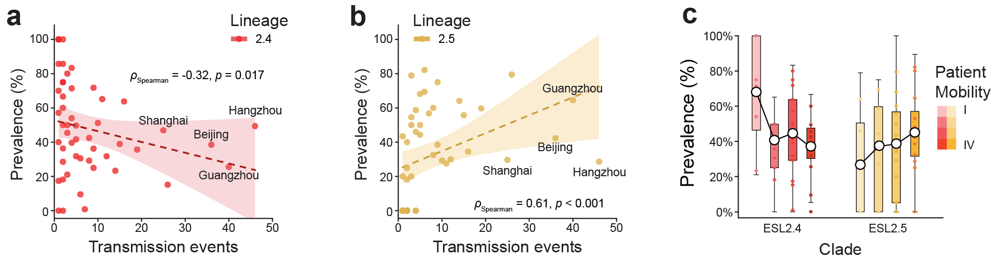

# Healthcare Infrastructure Shapes Evolutionary Trade-offs and Geographic Dissemination of Multidrug-Resistant *Acinetobacter baumannii*

This repository contains the analysis code, processed data and model implementation accompanying the study **Healthcare Infrastructure Shapes Evolutionary Trade-offs and Geographic Dissemination of Multidrug-Resistant *Acinetobacter baumannii***.

The study combines phylogenomics, phylogeography, sampling-sensitivity analyses, urban healthcare indicators, lineage-associated genomic variation, phenotype experiments and a spatial population-genetic model to examine the dissemination and ecological differentiation of the major ESL2 lineages in China.

## Repository map

| Section | Scope | Main entry point |
| --- | --- | --- |
| 1. Phylogenomics and transmission inference | Dated phylogeny, empirical city network, dissemination distance and velocity, temporal-signal tests, recombination masking and sampling sensitivity | [`1_Phylogenomics_and_Transmission_Inference/`](1_Phylogenomics_and_Transmission_Inference/) |
| 2. Evolutionary signatures and phenotypes | City-level associations, lineage-associated SNP-density peaks, antimicrobial susceptibility and experimental phenotypes | [`2_Evolutionary_Signatures/`](2_Evolutionary_Signatures/) |
| 3. Spatial transmission model | Synthetic city-network model of genotype competition, invasion and mobility intervention | [`3_AB_network/`](3_AB_network/) |

Each analysis directory separates `data/` from `code/` where possible. Its local README identifies the input tables, calculation steps, derived outputs, statistical unit and expected figure.

## 1. Phylogenomics and transmission inference

The [phylogenomics module](1_Phylogenomics_and_Transmission_Inference/) contains the shared genome metadata, dated tree, normalized city-to-city transmission table and the analyses used to assess their robustness.

### Time-resolved phylogeny and temporal signal

Root-to-tip regression is evaluated for the combined ESL2 collection and separately for ESL2.3, ESL2.4 and ESL2.5. ESL2.4 (R = 0.33, permutation P = 0.001) and ESL2.5 (R = 0.36, permutation P = 0.001) provide the lineage-specific temporal signal used for molecular dating. ESL2.3 yielded R = 0.01 and permutation P = 0.974 and is excluded from downstream temporal estimates. Data, summary statistics and plotting scripts are in [`temporal_signal/`](1_Phylogenomics_and_Transmission_Inference/temporal_signal/).

> **Figure: lineage-specific temporal signal**
> Add `1_Phylogenomics_and_Transmission_Inference/temporal_signal/root_to_tip_temporal_signal.png` here. The figure should contain the combined, ESL2.3, ESL2.4 and ESL2.5 root-to-tip regression panels.

### Date randomisation

Sampling dates are permuted among tips ten times. Within each permutation, the correlation is evaluated in ten independent 50% subsamples, and the median of those ten correlations represents the permutation. The observed estimate and its sampling interval are retained separately from the null distribution.

> **Figure: date randomisation**
> Add `1_Phylogenomics_and_Transmission_Inference/temporal_signal/date_randomisation.png` here. The figure should compare the observed correlation and sampling interval with the ten permutation-level medians for each lineage.

### Temporal-signal sampling sensitivity

The same temporal-signal statistic is evaluated under random, population-weighted, year-balanced, city-balanced and combined city/year-balanced sampling in [`temporal_signal/sampling_sensitivity/`](1_Phylogenomics_and_Transmission_Inference/temporal_signal/sampling_sensitivity/).

> **Figure: temporal-signal sampling sensitivity**
> Add `1_Phylogenomics_and_Transmission_Inference/temporal_signal/sampling_sensitivity/temporal_signal_sampling_sensitivity.png` here. The figure should show lineage-specific estimates across all five sampling strategies.

### Recombination masking

[`recombination/`](1_Phylogenomics_and_Transmission_Inference/recombination/) contains chromosome-wide RecHMM, Gubbins and ClonalFrameML profiles summarized in consecutive 10-kb windows. The phylogenetic block spans NC_017847.1 positions 1,215,000-2,930,999; recombination masking reduced its SNP set from 35,609 to 23,524. The directory provides the source workbook, standardized event tables, block coordinates and scripts for regenerating the recombination landscape.

> **Figure: recombination landscape**
> Add `1_Phylogenomics_and_Transmission_Inference/recombination/recombination_landscape.png` here. The figure should show the three recombination profiles, mutation events and the low-recombination block used for phylogenetic reconstruction.

### Empirical transmission structure

The empirical network is a city-level phylogeographic transition network reconstructed from changes in geographic state along the dated phylogeny. Nodes represent sampled cities, directed edges represent inferred intercity transitions and edge weights record normalized transition counts. [`Network.py`](1_Phylogenomics_and_Transmission_Inference/Network.py) evaluates the resolution scan, within- versus cross-module connection weights, transmission between city levels and transmission weight by city hierarchy.

  

### Transmission-network sampling sensitivity

[`network_sensitivity/`](1_Phylogenomics_and_Transmission_Inference/network_sensitivity/) reconstructs the empirical network under five geographic and temporal sampling strategies and compares network metrics and community assignments using NMI and ARI.

> **Figure: transmission-network sampling sensitivity**
> Add `1_Phylogenomics_and_Transmission_Inference/network_sensitivity/network_sampling_sensitivity.png` here. The figure should show the network-metric intervals and community-stability results across the five strategies.

### Dissemination distance and velocity

[`Speed.py`](1_Phylogenomics_and_Transmission_Inference/Speed.py) combines geographic distance between reconstructed parent/descendant locations with the corresponding branch-time interval. It reports lineage-specific spread-speed distributions for 2010-2019 and 2020-2023 and cumulative geographic distance over 20 years of evolutionary time.

  

### SNP-distance validation of spatial spread

[`snp_distance_validation/`](1_Phylogenomics_and_Transmission_Inference/snp_distance_validation/) provides pair-level comparisons between divergence time and recombination-masked SNP distance, SNP-based year calibration, geographic-distance bins and period-specific kilometres-per-SNP summaries.

> **Figure: SNP-distance validation**
> Add `1_Phylogenomics_and_Transmission_Inference/snp_distance_validation/snp_distance_validation.png` here. The figure should summarize divergence time versus SNP distance, geographic spread versus SNP distance and the period-specific km-per-SNP comparison.

### Sampling sensitivity of lineage prevalence

Annual and overall ESL2.3, ESL2.4 and ESL2.5 proportions are recalculated using random downsampling, year balancing, city balancing and combined city/year balancing in [`clade_prevalence_sensitivity/`](1_Phylogenomics_and_Transmission_Inference/clade_prevalence_sensitivity/).

> **Figure: clade-prevalence sampling sensitivity**
> Add `1_Phylogenomics_and_Transmission_Inference/clade_prevalence_sensitivity/clade_prevalence_sampling_sensitivity.png` here. The figure should compare the observed annual lineage proportions with the intervals from all four resampling schemes.

## 2. Evolutionary signatures and phenotype experiments

The [evolutionary-signatures module](2_Evolutionary_Signatures/) links city characteristics and genomic measurements to observed lineage distributions, and provides the experimental measurements used to compare ESL2.4 and ESL2.5.

### City connectivity and patient mobility

[`Degree.py`](2_Evolutionary_Signatures/Degree.py) joins normalized city-level transmission counts with lineage prevalence and calculates Spearman associations for ESL2.4 and ESL2.5. The same city table assigns patient-mobility strata for the lineage-prevalence comparison shown in the third panel.

  

### Urban attributes and multivariate modelling

[`ChinaCityInfo.xlsx`](2_Evolutionary_Signatures/ChinaCityInfo.xlsx) contains the curated city attributes, and [`TrueValueOI.xlsx`](2_Evolutionary_Signatures/TrueValueOI.xlsx) contains the provincial outpatient/inpatient indicators. The analyses rank univariate Spearman correlations, summarize joint variation by RDA and estimate the grouped development, mobility, medical-quality and medical-pressure paths by SEM.

  

### Multiple testing of city-level associations

[`city_associations/`](2_Evolutionary_Signatures/city_associations/) retains permutation-based Spearman tests for 22 city variables, nominal P values, Benjamini-Hochberg adjustment and Storey q-values. The smallest Storey q-value is 0.0768 for air pollution; the directory contains the complete table and plotting scripts.

> **Figure: city-variable multiple testing**
> Add `2_Evolutionary_Signatures/city_associations/city_association_multiple_testing.png` here. The figure should display the nominal permutation P values and Storey q-values for all 22 variables.

### Gene disruptions and functional enrichment

[`ESL2.5_Pseudogenes.txt`](2_Evolutionary_Signatures/ESL2.5_Pseudogenes.txt) records disruption frequencies across ESL2.1-ESL2.5 together with gene annotations and COG categories. These frequencies support the lineage comparison, COG heat map and KEGG enrichment panels; the mutation tables provide the chromosome-wide density series.

  

### Annotated SNP-density peaks

[`snp_density/`](2_Evolutionary_Signatures/snp_density/) provides parallel 10-kb profiles for all annotated SNPs and the protein-changing subset. The largest ESL2.5 peak, at 3,897,000-3,897,999 bp, contains 65 variants: 54 synonymous and 11 protein-changing. Effect-type counts and gene annotations are retained for every highlighted window so that the composition of each peak can be inspected directly.

> **Figure: annotated SNP-density peaks**
> Add `2_Evolutionary_Signatures/snp_density/snp_density_peaks.png` here. The figure should compare all-SNP and nonsynonymous profiles and annotate the principal peaks, including the high-synonymous peak.

### Phenotype experiments

The [phenotype-experiment section](2_Evolutionary_Signatures/phenotype_experiments/) is organized by assay:

| Experiment | Available material | Figure position |
| --- | --- | --- |
| [Antimicrobial susceptibility](2_Evolutionary_Signatures/phenotype_experiments/antimicrobial_susceptibility/) | Isolate-level S/I/R calls, drug-level comparisons and FDR-adjusted statistics | `2_Evolutionary_Signatures/phenotype_experiments/antimicrobial_susceptibility/antimicrobial_susceptibility.png` |
| [Capsular polysaccharide](2_Evolutionary_Signatures/phenotype_experiments/capsular_polysaccharide/) | Uronic-acid measurements, isolate summaries and lineage/KL-type comparisons | `2_Evolutionary_Signatures/phenotype_experiments/capsular_polysaccharide/capsular_polysaccharide.png` |
| [Gene-expression qPCR](2_Evolutionary_Signatures/phenotype_experiments/gene_expression_qpcr/) | Technical Ct replicates, isolate-level normalization and target-wise comparisons | `2_Evolutionary_Signatures/phenotype_experiments/gene_expression_qpcr/gene_expression_qpcr.png` |
| [A549-cell adhesion](2_Evolutionary_Signatures/phenotype_experiments/a549_adhesion/) | Source plate counts, focused isolate comparison and isolate-level statistics | `2_Evolutionary_Signatures/phenotype_experiments/a549_adhesion/a549_adhesion.png` |
| [Mouse nasal colonisation](2_Evolutionary_Signatures/phenotype_experiments/nasal_colonisation/) | Longitudinal mouse-level bacterial loads and time-point-specific comparisons | `2_Evolutionary_Signatures/phenotype_experiments/nasal_colonisation/nasal_colonisation.png` |
| [Systemic-infection survival](2_Evolutionary_Signatures/phenotype_experiments/systemic_infection_survival/) | Mouse-level event data, Kaplan-Meier estimates and log-rank analysis | `2_Evolutionary_Signatures/phenotype_experiments/systemic_infection_survival/systemic_infection_survival.png` |
| [Transmission electron microscopy](2_Evolutionary_Signatures/phenotype_experiments/transmission_electron_microscopy/) | Experimental protocol and image-acquisition settings | `2_Evolutionary_Signatures/phenotype_experiments/transmission_electron_microscopy/transmission_electron_microscopy.png` |
| [Nasal secretory IgA](2_Evolutionary_Signatures/phenotype_experiments/secretory_iga/) | Experimental protocol and ELISA readout procedure | `2_Evolutionary_Signatures/phenotype_experiments/secretory_iga/secretory_iga.png` |

The independent experimental unit is defined in each assay README. A549 comparisons use the isolate mean, qPCR technical replicates are averaged within isolates, and longitudinal colonisation measurements retain the mouse as the unit.

## 3. Spatial transmission model

[`3_AB_network/`](3_AB_network/) contains a synthetic population-genetic simulation of competing transmission strategies across a heterogeneous city network. It supports basic, invasion and three-phase mobility-intervention scenarios.

The simulation uses synthetic city nodes and mobility links to test how metropolitan/peripheral mobility structure and contrasting colonisation/infection strategies affect genotype persistence. Network construction, fitness parameters and migration rates are defined in [`config.py`](3_AB_network/config.py); the [model README](3_AB_network/README.md) describes the basic, invasion and three-phase mobility-intervention scenarios.

> **Figure: spatial transmission model**
> Add `3_AB_network/model_summary.png`. The figure should show the synthetic network, lineage-frequency trajectories and the basic/invasion/mobility-intervention scenarios. Existing sensitivity PDFs remain available under [`3_AB_network/example_res/sensitivity_results/`](3_AB_network/example_res/sensitivity_results/).

## Reproducing an analysis

Reproduction is organized by analysis module. For a specific result:

1. Open the relevant module README from the map above.
2. Check the stated source table, statistical unit and assumptions.
3. Run the script from its analysis directory so that its relative `data/` paths resolve correctly.
4. Compare the regenerated table with the included derived output before recreating a figure.

Large raw sequencing files and the low-recombination-block FASTA remain external to this repository. The repository contains the processed inputs used by the documented downstream analyses. Each module README maps source tables to calculation scripts, derived outputs and the expected figure filename.

## Software requirements

Most tabular analyses use Python 3.10 or later. Common packages are:

- NumPy, pandas and SciPy
- Matplotlib and seaborn
- openpyxl
- NetworkX, python-louvain and ETE Toolkit
- Plotly for interactive model output

The phenotype module provides its [Python dependency declaration](2_Evolutionary_Signatures/phenotype_experiments/#python-dependencies), and the simulation has a separate [`requirements.txt`](3_AB_network/requirements.txt). Individual scripts may use only a subset of these packages.

Upstream phylogenomic reconstruction additionally used EToKi, IQ-TREE 2, RecHMM, Gubbins, ClonalFrameML, TempEst, TreeTime and BEAST 2. Selected multivariate analyses use R. Install these tools separately when rebuilding the corresponding upstream results.

## Citation

If you use this repository, its code or processed source data, please cite the accompanying paper:

Li S, Wu Y, Zhou Y, Zhong L, Jiang Y, Wang Y, Li J, Lin H, Li H, Xia S, Du H, Zhang R, Lou Y, Wang S, *et al.* **Healthcare Infrastructure Shapes Evolutionary Trade-offs and Geographic Dissemination of Multidrug-Resistant *Acinetobacter baumannii*.**

Please also cite the original software and external data sources relevant to the analysis being reused.

## License

See [`LICENSE`](LICENSE).
